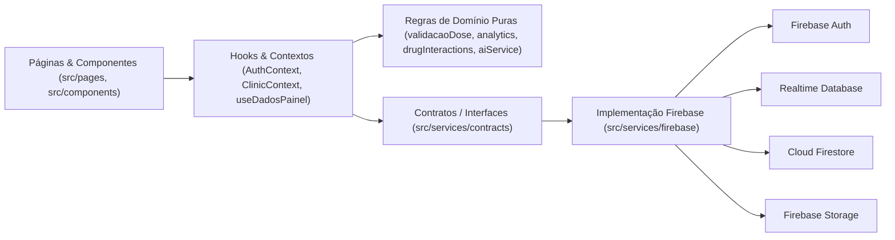

# 🧠 NeuroDose Assist

> Plataforma web clínica de suporte à decisão farmacológica, gestão de prontuários e acompanhamento posológico para neurologia e neuropsiquiatria.

[](https://react.dev/)
[](https://www.typescriptlang.org/)
[](https://vitejs.dev/)
[](https://tailwindcss.com/)
[](https://firebase.google.com/)
[](https://vitest.dev/)

🔗 **Demo ao vivo:** [neuro-dose.vercel.app](https://neuro-dose.vercel.app/)

---

## 📋 Objetivo e Visão Geral

O **NeuroDose Assist** é uma aplicação web Full-Stack projetada para médicos neurologistas, psiquiatras e clínicas que precisam acompanhar tratamentos farmacológicos com precisão e rastreabilidade.

A plataforma centraliza o prontuário de pacientes, o catálogo de medicamentos e o histórico de doses, oferecendo:
- **Validação de segurança posológica** (verificação de limites mínimo e máximo por medicamento);
- **Detecção automática de interações medicamentosas** entre classes terapêuticas e princípios ativos;
- **Análise clínica pós-dose** baseada no estado subjetivo do paciente (humor, energia, sono e efeitos adversos);
- **Telemetria, analytics preditivo e exportação de relatórios em PDF**;
- **Gestão colaborativa de clínicas**, permitindo que equipes médicas compartilhem dados com controle de papéis.

---

## ✨ Funcionalidades (Módulos do Sistema)

| Módulo | Rota | O que faz |
| :--- | :---: | :--- |
| **Autenticação** | `/login` | Login com e-mail/senha, cadastro de conta profissional e autenticação federada via Google, com proteção de rotas privadas. |
| **Dashboard Principal** | `/` | Painel de controle com atalhos rápidos, 4 KPIs (pacientes ativos, doses em 7 dias, eficácia média e inferências), curva de eficácia × dose (7d), última aplicação, pacientes recentes, alertas farmacológicos e próximos atendimentos. |
| **Pacientes** | `/patients` | CRUD completo de prontuários com idade, gênero, condição principal, histórico clínico, alergias e prescrições estruturadas por paciente. |
| **Medicamentos & Interações** | `/medications` | Catálogo farmacológico por classe terapêutica (ISRS, IRSN, psicoestimulante, antipsicótico atípico, estabilizador de humor, benzodiazepínico), faixas seguras (`minDose`–`maxDose`) e **detector de interações** (grave, moderada e leve) com recomendações clínicas. |
| **Registro de Dose & Análise Clínica** | `/dose` | Fluxo guiado em 3 etapas (*Informações da Dose → Estado Subjetivo → Confirmação*) com validação de limites e geração automática de recomendação, estimativa de eficácia (`%`), avaliação de riscos e insights pós-dose. |
| **Histórico & Auditoria** | `/history` | Consulta filtrável de todas as doses registradas, trilha de auditoria (*Log de Atividades* da clínica) e exportação do histórico em PDF. |
| **Agenda Clínica** | `/appointments` | Calendário mensal interativo e painel diário para agendamento de consultas, retornos e exames, com controle de status (`Agendada`, `Confirmada`, `Concluída`, `Cancelada`). |
| **Analytics Preditivo** | `/analytics` | Análise por paciente e período: taxa de aderência, tendências de eficácia/humor/energia, identificação de padrões de risco e previsão semanal (*forecast*) com sugestão de ajuste posológico. |
| **Relatórios em PDF** | `/reports` | Geração de relatórios clínicos personalizados por paciente e intervalo de datas via `jsPDF` e `jspdf-autotable`, com opção de incluir gráficos e recomendações. |
| **Gestão de Clínica** | `/clinic` | Criação de clínica compartilhada, papéis (`Proprietário`, `Administrador`, `Membro`), remoção de membros e envio de convites por e-mail via **EmailJS**. |
| **Configurações** | `/settings` | Gestão de perfil médico (nome, CRM, especialidade, telefone), alteração de senha, preferências de notificações e nível de confiança da análise clínica. |

### Sobre o Motor de Análise Clínica (`aiService.ts`)

O módulo de análise pós-dose combina regras farmacológicas determinísticas em `src/services/aiService.ts`, base de conhecimento de medicamentos neuropsiquiátricos (`src/services/medicationKnowledge.ts`) e detector de interações (`src/services/drugInteractions.ts`). A interface já está estruturada de forma desacoplada para futura integração com modelos de linguagem (LLM) externos, se desejado.

---

## 🏗️ Arquitetura do Sistema

O projeto aplica princípios **SOLID** (especialmente Responsabilidade Única e Inversão de Dependência): páginas e hooks não importam o SDK do Firebase diretamente, consumindo **contratos tipados** em `src/services/contracts/` implementados pela camada `src/services/firebase/`.



- **`AuthContext`**: gerencia sessão, credenciais e proteção de rotas.
- **`ClinicContext`**: resolve o `effectiveUserId` (UID individual ou UID do proprietário da clínica compartilhada), permitindo operação individual ou multiusuário transparente.

---

## 🛠️ Tecnologias Utilizadas

| Camada | Tecnologias |
| :--- | :--- |
| **Front-End** | React 18, TypeScript 5.8, Vite 5 (SWC), React Router DOM 6, TanStack React Query |
| **Interface & Design** | Tailwind CSS 3.4, Radix UI (shadcn/ui), Lucide React, Tipografia Inter |
| **Gráficos & PDF** | Recharts, jsPDF, jspdf-autotable |
| **Backend & Dados** | Firebase Authentication, Realtime Database, Cloud Firestore, Firebase Storage |
| **Comunicação** | EmailJS (envio de convites para equipe da clínica) |
| **Testes & Qualidade** | Vitest, Testing Library, jsdom, `@vitest/coverage-v8`, ESLint |
| **Deploy & Observabilidade** | Vercel, Vercel Analytics, Vercel Speed Insights |

---

## 📁 Estrutura do Projeto

```text
neuro-dose-assist/
├── src/
│   ├── components/
│   │   ├── alerts/          # Painel de alertas de interação medicamentosa
│   │   ├── analytics/       # Gráficos de aderência, tendências, riscos e previsão
│   │   ├── dashboard/       # KPIs, curva de eficácia, anel de eficácia, atalhos, pacientes recentes
│   │   ├── dose/            # Wizard de registro de dose em 3 etapas e resultado da análise
│   │   ├── historico/       # Filtros, abas, lista de registros, auditoria e diálogo de detalhes
│   │   ├── layout/          # MainLayout, Sidebar escura colapsável e Header
│   │   ├── login/           # Painel institucional, formulários e botão Google
│   │   ├── painel/          # Composição das seções do Dashboard
│   │   └── ui/              # Primitivos acessíveis (Radix UI / shadcn/ui)
│   ├── contexts/            # AuthContext e ClinicContext
│   ├── hooks/               # Hooks de domínio e estado (useDadosPainel, useEnvioDose, etc.)
│   ├── lib/                 # Funções puras (validação, estatísticas, analytics, PDF, e-mail, Firebase init)
│   ├── pages/               # 11 páginas principais (lazy loaded)
│   ├── services/
│   │   ├── contracts/       # Interfaces de abstração (IAuthService, IPatientService, etc.)
│   │   ├── firebase/        # Implementações concretas dos serviços Firebase
│   │   ├── aiService.ts     # Motor de análise clínica pós-dose
│   │   ├── drugInteractions.ts
│   │   └── medicationKnowledge.ts
│   └── test/                # 42 testes unitários (regras de domínio + serviços mockados)
├── .env.example             # Modelo de variáveis de ambiente
├── package.json
└── README.md
```

---

## 🚀 Como Rodar Localmente

### Pré-requisitos
- [Node.js](https://nodejs.org/) 18+

### Passo a Passo

```bash
# 1. Clone o repositório
git clone <URL_DO_REPOSITORIO>
cd neuro-dose-assist

# 2. Instale as dependências
npm install

# 3. Crie o arquivo .env a partir de .env.example e preencha as variáveis necessárias
cp .env.example .env

# 4. Inicie o servidor de desenvolvimento
npm run dev
```

---

## 🧪 Scripts e Testes Automatizados

| Comando | Descrição |
| :--- | :--- |
| `npm run dev` | Inicia o servidor local de desenvolvimento (Vite) |
| `npm run build` | Gera o build otimizado de produção |
| `npm run preview` | Pré-visualiza o build de produção localmente |
| `npm run lint` | Executa a análise estática com ESLint |
| `npm test` | Executa toda a suíte de testes unitários (`vitest run`) |
| `npm run test:watch` | Executa o Vitest em modo interativo (*watch*) |

A suíte atual conta com **42 testes unitários** distribuídos em 8 arquivos cobrindo regras puras de domínio (`validacaoDose`, `calculadoraEstatisticas`, `geradorAlertas`, `analytics`) e a camada de serviços mockados.

---

## ⚠️ Aviso Clínico

O **NeuroDose Assist** é uma ferramenta de apoio tecnológico e acadêmico para organização clínica e suporte à decisão. As análises, estimativas e alertas gerados **não substituem o julgamento médico profissional**, protocolos clínicos oficiais ou a responsabilidade de prescrição do profissional habilitado.

---

## 🤝 Como Contribuir

1. Faça um fork do projeto
2. Crie uma branch para sua feature: `git checkout -b feature/minha-feature`
3. Commit suas mudanças: `git commit -m 'feat: adiciona minha feature'`
4. Push para a branch: `git push origin feature/minha-feature`
5. Abra um Pull Request

---

## 👨‍💻 Autor

**Gabriel Maia** — Desenvolvedor Full-Stack

[](https://linkedin.com/in/gabriel-maia-90b228289/)
[](https://github.com/Gbarielmito)
[](https://portfolio-bice-theta-81.vercel.app/)
